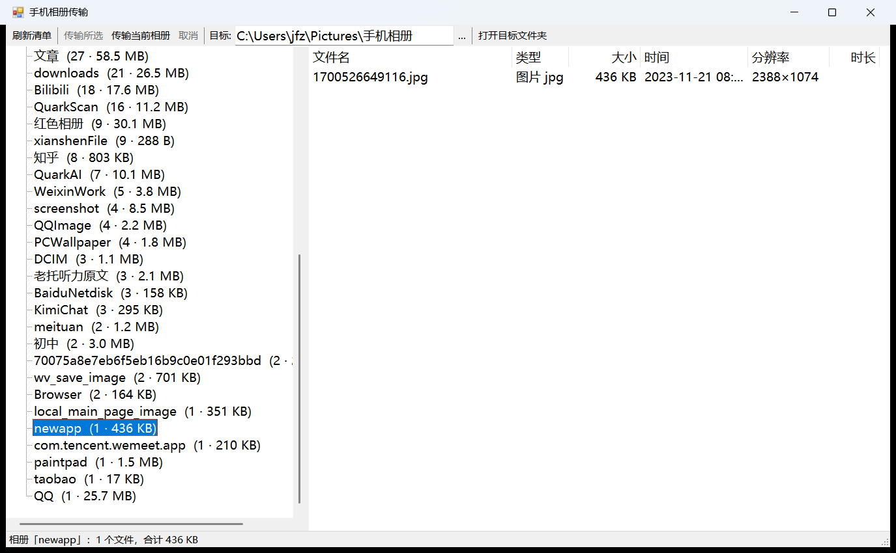

# 手机相册传输 · PhoneAlbum

在电脑上**按手机相册的样子**浏览照片和视频，勾选需要的再传，不用把几十 GB 全量同步一遍。

> Windows 10 / 11 · 绿色单文件 · 无需安装 · 内置 adb



---

# 一、为什么要写这个东西

## 问题 1：手机里的文件名根本没法看

想从手机拷几张照片，打开文件夹看到的是这些：

```
1745810346100.jpg                    ← 13 位时间戳，没人读得出来
tb_image_share_1756690866598.jpg.png ← 双扩展名，淘宝存图的老 bug
Image_446158920605739.jpg            ← 随机 ID，跟时间毫无关系
IMG_20261021_155747_1.jpg            ← 同一秒拍两张，只能加序号
1786750722714                        ← 连扩展名都没有
```

这些散落在 `DCIM/`、`Pictures/` 下面几十个文件夹里，还混着大量 App 缓存目录。**靠文件名找图，基本靠猜。**

## 问题 2：Windows 资源管理器看手机，信息是错的

用数据线把手机连上 Windows（MTP 协议），能浏览文件，但是：

- **没有"相册"这个概念**，只有目录树
- **拍摄时间显示 1899 年**——MTP 返回的时间戳是无效的
- 大目录枚举极慢，几千个文件要等半分钟
- 缩略图经常加载不出来

## 问题 3：全量同步是浪费

手机相册有 30 GB、4000 多个文件。但你要的可能只是"上个月拍的"或者"某个自建相册"。

为了几十张图去等半小时全量同步，然后再在电脑上删掉不要的——这个流程本身就是反的。

## 问题 4：手机存满了，却不知道该删什么

Android 的空间大头在 App 私有数据里，系统设置里只能看到"微信占了 20 GB"这种粗略数字，具体是哪些文件，看不到。

---

# 二、这个软件怎么解决

**不扫文件系统，直接读 Android 的 MediaStore。**

MediaStore 是手机图库自己用的那份媒体索引。读它意味着：

- ✅ **相册分组和你手机图库里看到的一模一样**（相机 / 截屏 / 录屏 / 各 App 目录 / 你自建的相册）
- ✅ **拍摄时间是真实的**，不是 1899
- ✅ **其他 App 存的图也会出现**（微信、QQ、B站、知乎、淘宝……）
- ✅ 读一次只要 2–3 秒，全部元数据到手

拿到清单之后，你先看、先挑，**只传你要的**。

---

# 三、基本功能

## 左侧：相册树

```
手机相册
 ├ 全部            (3936 · 29.49 GB)
 ├ 全部图片        (3855)
 ├ 全部视频        (81)
 ├ —— 相册 ——
 ├ 相机            (2172 · 27.72 GB)
 ├ 截屏            (737 · 499.1 MB)
 ├ WeChat          (94 · 34.6 MB)
 ├ QQ              (69 · 119.0 MB)
 └ ...
```

每个相册都标了**数量 · 体积**，按文件数排序，体积大的自然排在前面。

## 右侧：文件列表

| 列 | 说明 |
|---|---|
| 文件名 | |
| 类型 | 图片 / 视频 + 格式 |
| 大小 | |
| 时间 | 拍摄时间（MTP 模式下显示"未知"） |
| 分辨率 | 如 4000×3000 |
| 时长 | 视频才有 |

**点列头可以排序**——按时间倒序找最新素材，按大小找占地方的大视频。

## 传输

- **右键相册** → 传输整个相册
- **多选文件** → 传输所选（Ctrl 点选 / Shift 连选 / Ctrl+A 全选）
- **「传输当前相册」按钮** → 传当前显示的全部
- 实时进度条、速度、可中途取消
- **自动按相册分子目录**保存
- **已存在且大小相同的文件自动跳过**，可以反复点，不会重传

---

# 四、开始使用（一步步来）

## 第 1 步：下载

到 [Releases](../../releases) 页面下载 `PhoneAlbum-v*-win64.exe`。

**只有一个文件，双击就能运行。不需要解压，不需要安装。**

> 首次启动时，程序会自动把内置的 adb 释放到 `%LOCALAPPDATA%\PhoneAlbum\`，
> 大概需要 1–2 秒，之后每次启动都是秒开。这个过程你完全不用管。

文件放哪都行——桌面、下载文件夹、D 盘都可以，不会有权限问题。

## 第 2 步：连接手机

1. **用能传数据的线**插上电脑（很多 Type-C 线只能充电，不传数据——这是最常见的坑）
2. 手机通知栏会弹出 USB 用途选择，点它，选「**传输文件**」
   - 不要选「仅充电」
   - 不要选「传输照片」
3. 手机上可能弹出「**允许 USB 调试吗**」，勾选「始终允许」，点**允许**

> 如果你没看到第 3 步的弹窗，说明还没开 USB 调试——**没关系**，程序会自动用 MTP 模式工作，功能基本完整。想要完整体验再看下面的「第 5 步（可选）」。

## 第 3 步：双击运行

双击 `PhoneAlbum.exe`。

**你应该看到**：窗体出现，状态栏显示「正在读取手机相册索引...」，2–3 秒后左侧出现相册列表，右侧自动显示「全部」的文件。

如果左侧一直是空的，跳到下面的 [出问题了怎么办](#六出问题了怎么办)。

## 第 4 步：挑选并传输

1. **点左侧一个相册** → 右侧列出该相册的文件
2. **勾选你要的**（Ctrl 点选多个，Shift 连选，Ctrl+A 全选）
3. 点工具栏「**传输所选**」
4. 弹窗确认「要传 N 个文件，合计 X MB，存到 Y」→ 点确定
5. 观察进度条和速度
6. 传完自动打开目标文件夹

想传整个相册更快：**右键左侧相册** → 「传输此相册全部」。

目标目录默认是 `图片\手机相册`，可以在工具栏改。

## 第 5 步（可选）：开启 USB 调试，获得完整体验

**开不开都能用。** 区别只在精度和速度：

| | ADB 模式 | MTP 模式 |
|---|---|---|
| 前提 | 需开 USB 调试 | **只需插线选「传输文件」** |
| 速度 | ~37 MB/s | ~28 MB/s |
| 拍摄时间 | ✅ 准确 | ❌ 显示"未知" |
| 分辨率 / 时长 | ✅ 有 | ❌ 无 |
| 相册分组 | 与手机图库完全一致 | 按文件夹，基本一致 |
| 读取耗时 | 2–3 秒 | 20–40 秒 |

**程序会自动选择模式，不需要你手动切换。**

如果你只是偶尔传几张图，MTP 模式完全够用，这一节可以跳过。
想要完整体验（时间准确、速度更快），按下面三个阶段操作，**只需要做一次**。

---

### 阶段一：解锁「开发者选项」

新手机的开发者选项是**藏起来的**，必须用"连续点击版本号"的方式解锁。

| 品牌 | 路径 |
|---|---|
| **华为 / 荣耀** | 设置 → 关于手机 → 连点「**版本号**」7 次 |
| **小米 / 红米** | 设置 → 我的设备 → 全部参数与信息 → 连点「**MIUI 版本**」7 次 |
| **OPPO / 一加 / realme** | 设置 → 关于本机 → 版本信息 → 连点「**版本号**」7 次 |
| **vivo / iQOO** | 设置 → 系统管理 → 关于手机 → 连点「**软件版本号**」7 次 |
| **三星** | 设置 → 关于手机 → 软件信息 → 连点「**编译编号**」7 次 |
| **原生 Android / Pixel** | 设置 → 关于手机 → 连点「**版本号**」7 次 |
| **魅族** | 设置 → 关于手机 → 连点「**Flyme 版本**」7 次 |

**点对了会看到**：屏幕上弹出「您已处于开发者模式」或「再点 N 次即可成为开发者」。

**如果连点没反应**：说明你点的不是对的那个"版本号"，去「版本信息」「软件信息」「全部参数」这类子菜单里找。

> ⚠️ 部分机型（尤其较新的华为系统）要求**先登录厂商账号**才能解锁开发者选项。

### 阶段二：打开 USB 调试开关

解锁之后，开发者选项会出现在设置里：

- **华为 / 荣耀**：设置 → 系统和更新 → 开发人员选项
- **小米 / 红米**：设置 → 更多设置 → 开发者选项
- **OPPO / 一加 / realme**：设置 → 系统设置 → 开发者选项
- **vivo / iQOO**：设置 → 系统管理 → 开发者选项
- **三星**：设置 → 开发者选项
- 其他品牌：直接在设置顶部**搜索框搜「开发者」**

进去后找到「**USB 调试**」，打开开关。弹确认框就点确定。

> **开关是灰色的点不动？** 常见原因：
> - 手机正在锁屏 → 先解锁屏幕再进
> - 插着充电线且处于某种充电模式 → 拔线再试
> - 企业/学校管控的 MDM 设备 → 无法开启，只能用 MTP 模式
> - 个别小米机型需先登录小米账号并插 SIM 卡

### 阶段三：插线并授权

1. 插上数据线
2. 手机通知栏选「**传输文件**」
3. 手机弹出「**允许 USB 调试吗**」→ 勾选「**始终允许**」→ 点**允许**

> 弹窗里那串 RSA 密钥指纹是正常的，只在**首次**连接这台电脑时出现。

**弹窗一直不出现？**

- 拔插一次数据线重试
- 回到开发者选项，点「**撤销 USB 调试授权**」，然后重新插线
- 换一个 USB 口（前置面板的口经常有问题）
- 确认数据线真的能传数据（见下面「注意事项」里的数据线一节）

### 怎么确认真的开成功了

在 exe 所在的文件夹，地址栏输入 `cmd` 回车打开命令行，执行：

```
platform-tools\adb.exe devices
```

**成功的样子**（关键是最后那个 `device` 单词）：

```
List of devices attached
XHD0223518002309        device
```

对照下表判断：

| 输出 | 含义 | 怎么办 |
|---|---|---|
| 有设备号 + `device` | ✅ 成功 | 重开程序，自动走 ADB 模式 |
| 有设备号 + `unauthorized` | 授权没点 | 看手机屏幕，点「允许」 |
| 有设备号 + `offline` | 连接异常 | 拔插数据线 |
| **一片空白** | 没连上 | 换线 / 换 USB 口，或点程序里的「修复连接」 |
| 命令报"不是内部或外部命令" | 路径写错了 | 确认 `platform-tools` 文件夹就在当前目录下 |

成功后重开 `PhoneAlbum.exe`，**窗口标题会变成「手机相册传输」**（没有 `— MTP 模式` 后缀），状态栏也会显示更精确的统计。

---

# 五、注意事项（动手前务必看一遍）

## 数据线

**这是第一大坑。** 大量 Type-C 线是充电线，没有数据针脚，插上完全没反应。如果电脑毫无反应，先换线。

## USB 模式必须选「传输文件」

选「仅充电」什么都不给，选「传输照片」只暴露相机目录（DCIM），看不到别的。

## 首次启动会慢一两秒

单文件版第一次运行时，会把内置的 adb 解压到 `%LOCALAPPDATA%\PhoneAlbum\`。
这次启动会慢一两秒，之后就正常了。

如果某个安全软件拦截了这个释放动作，程序会提示找不到 adb——
点工具栏的「修复连接」，或把 `%LOCALAPPDATA%\PhoneAlbum` 加入白名单。

## 首次读取需要几秒

MediaStore 有 3000–5000 条记录，读取加解析约 2–3 秒。MTP 模式更慢（要遍历文件夹），可能 20–40 秒，属于正常。

## MTP 模式没有拍摄时间

这是协议限制，不是 bug。MTP 返回的时间是 1899 年，程序识别出来后显示「未知」，而不是显示一个假日期。

## 传输过程中别锁屏

手机息屏后部分机型会降速或断开。传输大文件时建议保持亮屏。

## 已存在的文件会被跳过

判断依据是「同名且大小一致」。所以：

- 可以反复点，不会重复传
- 但如果你手动改过本地文件，程序会认为它已存在，不会覆盖

## 中文相册名没问题

`其他`、`毛概`、`室内设计（《小家，越住越大》）` 这类名字实测能正常读取和传输（约 31 MB/s）。

## 传输速度参考

USB 2.0 手机上（绝大多数机型）：

| 场景 | 速度 |
|---|---|
| 批量照片 | ~35 MB/s |
| 单个大视频 | ~37 MB/s |

这已经吃满 USB 2.0 带宽（约 300 Mbps），换软件也快不了。瓶颈在物理带宽。

---

# 六、出问题了怎么办

## 症状：左侧一直是空的 / 提示"没找到手机"

按顺序排查，**每一步做完再重开程序试一次**：

### ① 换一根数据线

最常见的原因。手机连上电脑后，资源管理器里应该能出现设备图标。

### ② 确认手机选了「传输文件」

下拉通知栏，看 USB 用途选项。

### ③ 直接测 adb

打开 exe 所在的文件夹，在地址栏输入 `cmd` 回车，然后执行：

```
platform-tools\adb.exe devices
```

- **列出设备** → 连接正常，问题在授权或程序
- **一片空白** → 往下看 ④
- **显示 unauthorized** → 手机上点「允许 USB 调试」

### ④ 点程序里的「修复连接」按钮

在程序工具栏最右边有一个「**修复连接**」按钮。点它会弹出 UAC 提权确认（必须允许，因为要改注册表），然后自动：

1. 找出当前插着的 ADB 接口
2. 补上 Windows 通用驱动缺失的接口 GUID
3. 重启该 USB 接口
4. 打印修复后的设备列表

**为什么需要这个**：Windows 10/11 会给 ADB 接口自动绑定微软的通用 WinUSB 驱动，但这个驱动不会注册 adb 用来枚举设备的接口 GUID `{F72FE0D4-CBCB-407D-8814-9ED673D0DD6B}`，于是 adb 完全看不到手机——即使设备管理器里一切正常。

> 这个修复是**按 USB 口**生效的。换一个 USB 口插，需要重新跑一次。

### ⑤ 还是不行

试试 `--mtp` 参数强制走 MTP 模式：

```
PhoneAlbum.exe --mtp
```

MTP 模式不依赖 adb，只要 Windows 能识别手机存储就能工作。

## 症状：能读取，但选中文件传输失败

- 检查目标目录是否可写（换个盘试试）
- 检查磁盘剩余空间
- MTP 模式下如果单个文件超过 4 GB 可能失败（协议限制）

## 症状：程序界面被拉伸 / 显示不全

程序已声明 DPI 感知，会自动适配 125% / 150% 缩放。如果仍有问题，把 `layout.txt` 的内容反馈出来。

---

# 七、看不到哪些文件

程序只读取**共享存储中的媒体索引**，所以以下内容看不到：

| 看不到 | 原因 | 怎么办 |
|---|---|---|
| 微信聊天里的原图 | 在 App 私有目录，系统不索引 | 聊天里长按图片 →「保存到手机」 |
| App 私有数据 | `/data/data/` 无权限访问 | 需 root |
| `.nomedia` 标记的目录 | 系统故意不索引 | — |
| 文档、压缩包、安装包 | 不是媒体文件 | 用文件管理器或 `adb pull` |
| 通话录音、下载的 APK | 非媒体类型 | 同上 |

---

# 八、技术细节

- **C# 5 + WinForms**，用 Windows 自带的 `csc.exe` 编译，**不需要安装 .NET SDK**
- 运行时依赖 **.NET Framework 4.8**（Windows 10 1903+ 与 Windows 11 均自带）
- **单文件 4.27 MB**：adb（8.1 MB）+ 两个 dll + NOTICE 用 GZip 压缩后嵌进 exe，首次运行自动释放
- 数据来源：
  - ADB 模式：`adb shell content query --uri content://media/external/{images,video}/media`
  - MTP 模式：Windows Shell COM 遍历便携设备
- 传输：ADB 模式批量 `adb pull`；MTP 模式 `Shell.CopyHere`（UI 线程 + 消息泵）

## 从源码编译

```
src\build.bat
```

需要 `C:\Windows\Microsoft.NET\Framework64\v4.0.30319\csc.exe`（Windows 自带）。
打发布包：

```
pwsh -File tools\make-release.ps1
```

---

# 九、许可

本项目代码采用 **MIT License**，详见 [LICENSE](LICENSE)。

内置的 `platform-tools`（adb 等）版权归 **Android Open Source Project** 所有，遵循 Apache License 2.0，随包附带 `platform-tools/NOTICE.txt`。
